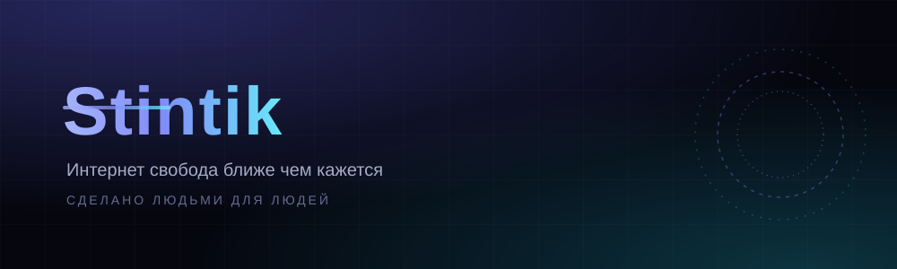

**«Интернет свобода ближе чем кажется»** · **«Сделано людьми для людей»**

---

## Обо мне

Человек из России, который любит **код, игры и свободный интернет**.
Пишу боты, собираю веб-проекты, ковыряюсь в консольном homebrew, перевожу open-source на русский.
Всё, что делаю — бесплатное и открытое.

## Проекты

| Направление | Проекты | О чём это |
|---|---|---|
| **Свободный интернет** | [StintikVPN](https://github.com/Stintik-123/StintikVPN) · [vpn-configs-russia](https://github.com/Stintik-123/vpn-configs-russia) | Агрегатор VPN-подписок и прокси: сайт, автопроверка ссылок, CI, 150+ звёзд |
| **PS5 homebrew** | контрибуции в [Overdrive](https://github.com/MyLuxy/overdrive) | Русификация лаунчера, кредит в официальном релизе v1.0.6 |
| **Steam и боты** | [SteamDeal](https://github.com/Stintik-123/SteamDeal) · [SteamDealBot](https://github.com/Stintik-123/SteamDealBot) · [GameVoice](https://github.com/Stintik-123/GameVoice) | Отслеживание скидок Steam и голосовые фишки для игр |
| **Инструменты** | [MegaThread](https://github.com/Stintik-123/MegaThread) | Утилиты и автоматизация рутины |

## Технологии

**Web:** JavaScript · HTML/CSS · GitHub Pages · GitHub Actions
**Боты:** Telegram Bot API · Steam Web API
**Прочее:** i18n и локализация · CI/CD · git

  
  

---

[Telegram](https://t.me/StintikVPN) · [Email](mailto:stintikvpn@proton.me) · [StintikVPN](https://stintik-123.github.io/StintikVPN/)

